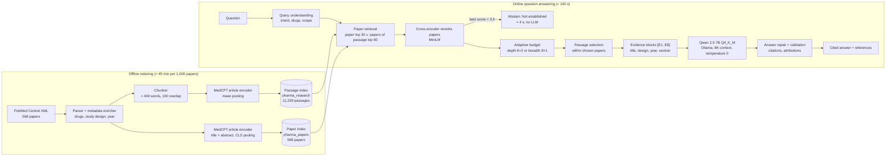
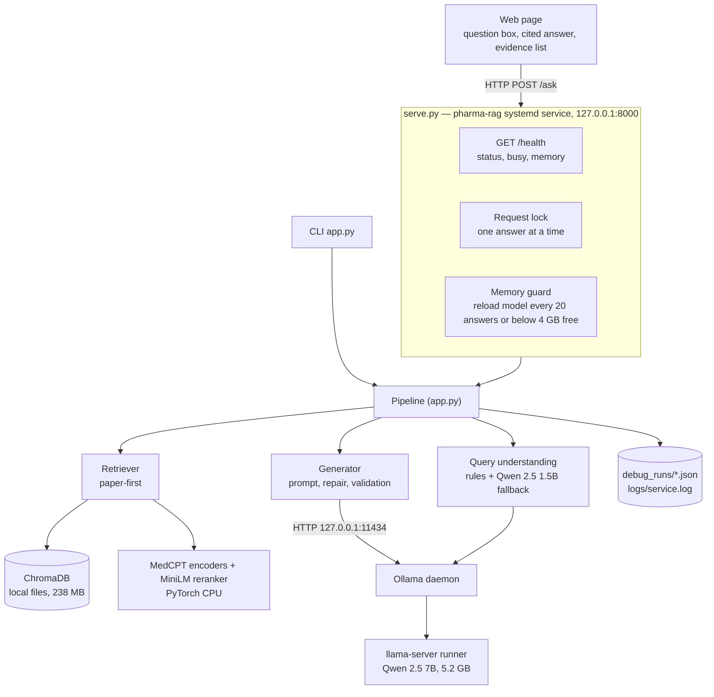
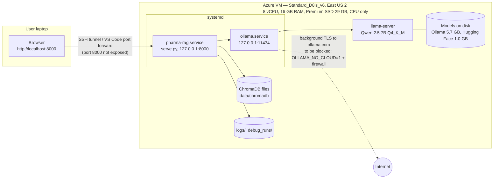
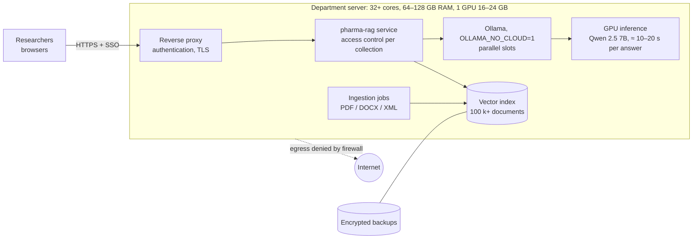

# Pharma Research Intelligence RAG — Project Presentation Package

Prepared: 2026-10-18 · Presenter: project owner · Audience: software engineering manager
All figures were measured on the project VM unless marked *estimated*. Items marked **[TO FILL]** need information that is not in the repository: business context and cost.
Source documents: `docs/PROJECT_STATE.md`, `docs/PIPELINE_REPORT.md`, `docs/LLM_EVALUATION.md`, `docs/MODEL_DEPLOYMENT_COMPARISON.md`, `docs/ENTERPRISE_DEPLOYMENT_ASSESSMENT.md`, `docs/OPERATIONS.md`.

---

## Contents
1. [Executive Summary](#1-executive-summary)
2. [Slide Content (22 slides)](#2-slide-content)
3. [Architecture Diagram](#3-architecture-diagram)
4. [Data Flow Diagram](#4-data-flow-diagram)
5. [Deployment Diagram](#5-deployment-diagram)
6. [Demo Script (5 minutes)](#6-demo-script-5-minutes)
7. [Expected Manager Questions and Answers](#7-expected-manager-questions-and-answers)
8. [Appendix](#8-appendix)

---

## 1. Executive Summary

**What was built:** a private research assistant that answers pharmaceutical research questions from a corpus of 568 full-text PubMed Central papers. Every claim cites the passage it comes from. When the papers do not contain the answer, it says so. It runs entirely on one CPU-only Azure VM: there are no cloud AI services and no per-question fees, and documents never leave the machine.

**Results (measured):**

| Outcome | Before | After |
|---|---|---|
| Expected facts reaching the model, single-paper questions (dev / held-out¹) | 50 % / 50 % | **88 % / 81 %** |
| Topic coverage, multi-paper questions (dev / held-out) | 0.41 / 0.30 | **0.66 / 0.53** |
| Facts in the evidence that the final answer states | — | **85 %** |
| Out-of-corpus questions answered with invented claims | — | **0 of 12** |
| Correct answers discarded by output validation | 5 | **0** (103 replayed answers) |
| Answer time (end-to-end median) | ≈ 120 s | **≈ 100–106 s** |
| Model memory after extended use (16 GB VM) | grew to 12.9 GB (crash risk) | **bounded at ≤ 7.8–8.6 GB** |
| Automated tests | 0 | **66** |

¹ Held-out questions were written after the system was designed and were never used for tuning.

**Key decisions:**
- **Paper-first retrieval** (find the right papers, then the right passages) doubled the evidence that reaches the model.
- **Qwen 2.5 7B, Q4_K_M quantization, stays the model.** Six alternatives and a higher-precision quantization were tested on identical evidence; none was better overall. Larger models were 2.3–2.5× slower for about one extra fact.
- **The memory crash risk is fixed.** Ollama's undocumented prompt cache grew by up to 8 GB; the fix is implemented and verified in the live service.

**Status:** ready for a single-user or small-team pilot once two administrator steps are applied: block Ollama's background connection to ollama.com (a one-line setting plus a firewall rule) and enable auto-start.

**Limitations:**
- About 15 % of available facts are still omitted.
- Answers take about 100 s on CPU.
- One question is answered at a time.
- There is no login or access control.
- Only PubMed Central XML can be ingested.

**What I am asking for:**
1. Approve a pilot with 3–5 researchers.
2. Approve the next work package: login and access control, ingestion of PDF/DOCX documents, and an answer-structure improvement.
3. Decide whether a GPU server is wanted for department scale. It would cut answers to about 10–20 s *(estimated)*.

---

## 2. Slide Content

> Main talk: slides 1–18, about 25 minutes. Backup: slides 19–22. Speaker notes are in *italics*.

### Slide 1 — Title
- **Pharma Research Intelligence Assistant**
- Private, evidence-grounded answers from research papers using a local AI model
- Name · Date · Project period: 2026-10-06 → 2026-10-16 (35 commits)

*Notes: one sentence: "A research assistant that answers from our own documents, cites its sources, and never sends data outside."*

### Slide 2 — Business problem
- Researchers answer questions by manually reading many papers.
- Public AI chat tools are not acceptable: data leaves the company, answers are not traceable, and they invent facts.
- Need: fast, cited, verifiable answers from a controlled corpus, kept private.
- **[TO FILL]** Target users, current time per question, number of questions per week.

*Notes: anchor the value in time saved and compliance.*

### Slide 3 — Objective and success criteria
| Priority | Criterion | Target |
|---|---|---|
| 1 | Correct answers | Expected facts stated; no invented claims |
| 2 | Evidence grounding | Every claim cited to a source passage |
| 3 | Reliable retrieval | Right evidence reaches the model |
| 4 | Acceptable latency | 90–150 s per answer on CPU |
| — | Constraints | Local only, CPU only, 8 vCPU / 16 GB VM |

*Notes: success criteria were fixed before tuning, and every change was measured against them.*

### Slide 4 — Solution at a glance
- Corpus: 8 drugs, 568 indexed papers, 11,239 passages.
- Question → find the relevant papers → pick the best passages → local LLM writes a cited answer → the answer is validated.
- Out-of-corpus questions get a "not established in the supplied evidence" answer in about 4 s.
- Delivered as a web page plus an HTTP API, running as a Linux service.

*Notes: show Diagram 3.1 here.*

### Slide 5 — Architecture
- Diagram 3.1 (high-level architecture).
- Offline: parse → enrich → two indexes (passages, papers).
- Online: analysis → paper retrieval → rerank → passage selection → generation → answer repair.
- No external services at runtime.

### Slide 6 — Technology stack
| Layer | Technology | Why |
|---|---|---|
| Corpus | PubMed Central open-access XML | Full text, licensed for reuse |
| Embeddings | MedCPT (biomedical retrieval encoders) | Domain-specific |
| Vector DB | ChromaDB 1.5.9 (embedded) | Simple, local, no server |
| Reranker | MiniLM cross-encoder | Fast; the biomedical alternative tested worse and 3× slower |
| LLM runtime | Ollama 0.40.2 (llama.cpp) | Local CPU inference |
| LLM | Qwen 2.5 7B Instruct, Q4_K_M | Best measured balance; Apache 2.0 |
| Service | Python standard-library HTTP + systemd | No extra dependencies |
| Quality | 66 unit tests, benchmark harness | Repeatable evaluation |

### Slide 7 — Key innovation: paper-first retrieval
- **Problem found:** the right paper was found 94 % of the time, but the answer passage only 35 %.
- **Cause:**
  - Questions and Results-section text are worded differently.
  - The reranker preferred Discussion over Results.
  - A cap of 2 passages per paper cut off answers.
- **Design:**
  1. Find papers using title and abstract, as well as passage matches.
  2. Rank the papers.
  3. Pick passages inside the best papers.
  4. If no paper is relevant enough, abstain without calling the LLM.
- **Adaptive budget:**
  - Single-study questions get 6 + 2 passages from the top papers.
  - Broad questions get 1 passage from each of 8 papers.

*Notes: this is the biggest quality win; Diagram 4 shows the flow.*

### Slide 8 — Evaluation framework
- 49 benchmark questions:
  - 24 single-paper questions with 68 expected facts;
  - 13 multi-paper questions;
  - 12 out-of-corpus controls.
- 22 of the 49 are **held-out** questions, written after the design and never used for tuning.
- The test harness runs the exact production code path.
- Model tests replay stored evidence, so differences come from the model alone.
- Metrics:
  - facts visible to the model, facts stated, citations, numerical errors;
  - abstention;
  - latency, RAM and CPU.
- Manual adjudication of disputed facts and flagged numbers.

*Notes: credibility slide. Every number in this deck comes from this framework.*

### Slide 9 — Retrieval results
| Metric | Before | After |
|---|---|---|
| Facts reaching the model, dev (52 facts) | 26 (50 %) | **46 (88 %)** |
| Facts reaching the model, held-out (16 facts) | 8 (50 %) | **13 (81 %)** |
| Single-paper questions with no evidence (dev / held-out) | 5 / 4 | **0 / 2** |
| Multi-paper topic coverage (dev / held-out) | 0.41 / 0.30 | **0.66 / 0.53** |

*Chart: grouped bars before/after. Notes: the gain also holds on held-out questions, so it is not overfitting.*

### Slide 10 — Answer quality
- **85 %** of facts present in the evidence are stated in the answer (50 of 59, full set).
- **0 of 12** out-of-corpus questions produced claims; 9 were answered "not established" in about 4 s without calling the LLM.
- **0** validation failures over 103 replayed answers, down from 5. Correct answers had been discarded by over-strict checks.
- Known gap: secondary statistics are sometimes omitted (for example a second p-value).

### Slide 11 — Model comparison
| Model (Q4_K_M unless noted) | Facts kept¹ | Median time | RAM | Verdict |
|---|---|---|---|---|
| **Qwen 2.5 7B** | **32/40 · 85 % full set** | **96 s** | **5.2 GB** | **Selected** |
| Qwen 2.5 7B Q8_0 | 28/40 | 116 s | 9.2 GB | No gain |
| Qwen 3 4B | 34/40 | 128 s | 4.0 GB | Verbose; 2 number errors |
| Qwen 3 8B | 32/40 · 81 % full set | 175 s | 6.4 GB | Slower |
| Llama 3.1 8B | 27/40 | 127 s | 6.0 GB | Weaker |
| Gemma 3 12B | 33/40 | 215 s | 9.8 GB | Too slow on CPU |
| Phi-4 14B | 33/40 | 224 s | 10.5 GB | Too slow on CPU |

¹ Screening set: 14 single-paper questions, 40 facts; ± 2 facts is run-to-run noise.

*Notes: same evidence for every model. Bigger models gained about 1 fact for 2.3× the time and twice the RAM. Total-cost scorecard: Qwen 2.5 7B Q4 scores 34 of 35.*

### Slide 12 — Root-cause analysis of the remaining fact loss
| Factor tested | Result |
|---|---|
| Bigger or newer model | Within ± 2 facts; no fix |
| Higher precision (Q8_0) | No gain; +30 % time, +4 GB RAM |
| Different prompt structure | Better citations, fewer facts |
| Less context (4 blocks) | Worse: 59 % vs 80 % |
| Evidence order | No significant effect |
| Answer length | No effect |
- **Conclusion:** the remaining loss comes from the model's judgement about which details are peripheral, plus answer-section templates that sometimes don't fit the question. It is not caused by model size, precision or context size.

### Slide 13 — Latency
- End-to-end about **100–106 s** median (p90 about 125 s); out-of-corpus questions 3.8 s.
- Breakdown of a typical answer:
  - reading the 3,300-token prompt: 43 s (≈ 45 %);
  - writing the 370-token answer: 51 s (≈ 54 %);
  - retrieval: about 5 s.
- Running Ollama on all 8 threads instead of its default 4 made it 18–25 % faster.
- Why it takes this long: CPU inference on 4 physical cores. A GPU would answer in about 10–20 s *(estimated)*.

*Chart: stacked bar of prefill / decode / retrieval.*

### Slide 14 — Resource utilization
| Resource | Usage |
|---|---|
| CPU | All 8 vCPUs while answering; idle otherwise |
| RAM | Model 5.2 GB; service 1.2–2.0 GB; query helper 1.4 GB (only when needed) |
| Disk | About 9 GB total stack; corpus 0.31 GB; 0.53 MB per paper |
| Throughput | About 35 answers per hour, one at a time |
| VM | Azure Standard_D8ls_v6 (East US 2), Premium SSD, 29 GB disk (70 % used) |

### Slide 15 — Critical fix: memory growth
- **Found:** Ollama keeps every prompt's working state in a RAM cache of up to 8 GB per model. There is no setting to limit it.
- **Before:** the model process grew from 5.2 to 12.9 GB over 40 answers. On a 16 GB VM with no swap, that means a crash after about 40 answers.
- **Fix:** the service reloads the model between requests (every 20 answers or below 4 GB free, about 6 s) and at start-up.
- **Verified over 75 live answers:**
  - memory at most 7.8–8.6 GB;
  - 0 errors;
  - identical evidence;
  - facts 107 vs 106 for the baseline;
  - no added latency in the tuned version.

*Chart: memory over time, before (rising line) vs after (sawtooth) from `memory.csv`.*

### Slide 16 — Privacy and security
- Measured during a live question: the service, Ollama and the model process communicated only inside the machine (loopback).
- No cloud AI. Hugging Face downloads are disabled at runtime. The vector database sends no telemetry.
- **Finding:**
  - Ollama opens a background connection to ollama.com at start-up.
  - It would forward requests for `*-cloud` model names there.
- **Fix:** `OLLAMA_NO_CLOUD=1` plus a firewall rule. Verified on an isolated instance; it needs an administrator to apply in production.
- Still needed:
  - login and access control;
  - encryption at rest;
  - a retention policy for stored questions and answers.

### Slide 17 — Deployment and scalability
- Diagram 5 (deployment).

| Hardware | Answer time | Users | Corpus |
|---|---|---|---|
| 16 GB laptop | 1.5–3 min | 1 occasional | 15–30 k docs |
| 32 GB laptop | 1.5–2 min (Apple: 20–45 s) | 1–2 | ≈ 150 k |
| **Current VM** | **≈ 100 s (measured)** | 5–10 active | ≈ 15 k more on current disk |
| Department GPU server | 10–20 s | 100–150 | 1 M+ |
- Disk grows by about 0.53 GB per 1,000 docs; indexing takes about 45 min per 1,000 docs.
- As the corpus grows, retrieval quality is the main risk.

*Laptop and server figures are estimated.*

### Slide 18 — Results vs objectives
| Objective | Status |
|---|---|
| Correct answers | ✅ 85 % of available facts; numbers checked |
| Grounding | ✅ Cited answers; 0 invented claims on 12 out-of-corpus questions |
| Reliable retrieval | ✅ 88 % / 81 % of facts reach the model |
| Latency 90–150 s | ✅ ≈ 100–106 s |
| Local, CPU-only, 16 GB | ✅ Fully local; memory bounded |
| Production readiness | ⚠ Pilot-ready after Ollama hardening and auto-start |

### Slide 19 — Challenges and fixes (backup)
| Challenge | Fix | Effect |
|---|---|---|
| Answer passages lost in dense retrieval | Paper-first retrieval | Facts reaching the model 50 % → 88 % |
| Correct answers discarded by validation | Targeted answer repair | Failures 5 → 0 |
| Line-wrapped CLI output broke citations | Ollama API instead of CLI | Facts stated 6 → 13 of 24 |
| Every randomized trial mislabeled | Rule-order fix in classifier | Correct study designs |
| Classification varied between runs | Deterministic tie-break, temperature 0 | Stable plans |
| Ollama used 4 of 8 threads | 8 threads | 18–25 % faster |
| Service setting rejected by Ollama (`keep_alive`) | Numeric parsing | Service answers again |
| Prompt cache memory growth | Reload policy | 12.9 → ≤ 7.8 GB |
| Ollama cloud connection | `OLLAMA_NO_CLOUD` + firewall | Documented |

### Slide 20 — Limitations (backup, or main talk if asked)
- About 15 % of available facts omitted, mostly secondary statistics.
- About 100 s per answer; one request at a time.
- No authentication or per-document access control.
- Ingests PubMed Central XML only; internal PDF/DOCX need new parsers.
- 49-question benchmark written by one labeler; retrieval thresholds calibrated on 568 papers.

### Slide 21 — Roadmap
| When | Item | Why |
|---|---|---|
| Now (hours) | Apply Ollama hardening; enable auto-start; add swap | Privacy and reliability |
| Next (weeks) | Login and access control; retention policy | Multi-user safety |
| Next | PDF/DOCX ingestion + retrieval re-benchmark at target size | Enterprise documents |
| Next | Answer-template fit + per-claim citation enforcement | Remaining fact loss |
| Later | GPU server; parallel requests; re-test larger models | Department scale, ≈ 10–20 s answers |
- **[TO FILL]** effort estimate per item.

### Slide 22 — Lessons learned and decision requested
- Measure before optimizing: most of the early hypotheses were disproven by data.
- A held-out test set prevents self-deception.
- Bigger models are not automatically better on constrained hardware.
- Operational behaviour (memory, network) matters as much as answer quality.
- **Decisions requested:**
  1. Pilot approval.
  2. Next work package.
  3. GPU server yes or no.

---

## 3. Architecture Diagram

### 3.1 High-level architecture


### 3.2 Component view


---

## 4. Data Flow Diagram

```mermaid
sequenceDiagram
    autonumber
    actor U as Researcher
    participant W as Web page
    participant S as Service (serve.py)
    participant Q as Query understanding
    participant R as Retriever
    participant C as ChromaDB
    participant X as Cross-encoder
    participant O as Ollama + Qwen 2.5 7B
    participant V as Answer repair

    U->>W: Types question
    W->>S: POST /ask
    S->>Q: Analyze (intent, drugs, scope)  ≈ 0 s
    Q-->>S: query_info
    S->>R: Retrieve evidence
    R->>C: Paper index top 30 + passage index top 60
    C-->>R: Candidate papers
    R->>X: Rank papers on title + abstract
    X-->>R: Paper scores
    alt Best paper score < 3.5
        R-->>S: Abstain
        S-->>W: "Not established in the supplied evidence"  ≈ 4 s
    else Relevant papers found
        R->>X: Select passages inside top papers
        X-->>R: 8 evidence passages  (≈ 5 s total)
        S->>O: Prompt: rules + 8 evidence blocks (≈ 3,300 tokens)
        O-->>S: Draft answer (≈ 370 tokens, ≈ 96 s)
        S->>V: Normalize citations, remove invented authors, repair
        V-->>S: Validated answer
        S-->>W: Answer + references + timings
    end
    W-->>U: Cited answer, clickable [E#] evidence
    S->>S: Save JSON record; reload model if memory guard is due
```

---

## 5. Deployment Diagram

### 5.1 Current deployment


### 5.2 Target department deployment *(estimated)*


---

## 6. Demo Script (5 minutes)

**Preparation (before the meeting):**
- Check `curl -s localhost:8000/health` shows `"status": "ok"` and `"busy": false`.
- Open the web page through the port forward.
- Run the main question once beforehand and keep that answer open in a second tab as a fallback.

| Time | Action | What to say |
|---|---|---|
| 0:00–0:30 | Show the web page and the green **Ready · qwen2.5:7b** status | "Everything runs on this one VM. No data leaves it, and there is no per-question cost." |
| 0:30–1:00 | Ask the out-of-corpus question: **"Does nivolumab treat malaria?"** | "First, a question the corpus cannot answer." The answer appears in about 4 s: *Not established in the supplied evidence.* "It refuses rather than invents. That decision is made by retrieval, before the AI model is even called." |
| 1:00–1:20 | Ask the main question: **"Which baseline serum biomarker predicted severe immune-related liver injury after nivolumab plus ipilimumab, and what cutoff was identified?"** | "Now a real research question. It takes about 1.5 minutes on CPU, so while it runs…" |
| 1:20–2:40 | Switch to the architecture diagram (3.1) | "…here is what is happening: it finds the relevant papers first, then the best passages inside them, then the local model writes an answer citing each passage, and we validate the citations." |
| 2:40–3:40 | Return to the answer (or the fallback tab) | Point at: KL-6 ≥ 400 U/mL, the clickable **[E1]** citations, and the evidence list with paper title, section and PMC link. "Every claim can be checked against the source in one click." |
| 3:40–4:20 | Click a citation, then open the PMC link | "This is the actual paper; the numbers match." |
| 4:20–5:00 | Show `/health` (memory section) | "The service monitors its own memory; we found and fixed a hidden 8 GB memory growth in the AI runtime." Close: "Ready for a pilot; next steps are login, document formats, and optionally a GPU." |

**Backup questions:**
- "Is the risk of serious infection different between infliximab and adalimumab in children with inflammatory bowel disease?" Expected: HR 1.15 (95 % CI 0.63–2.11), no difference.
- "What was the median progression-free survival with osimertinib in FLAURA?" Expected: 18.9 months vs 10.2 months.

**If something fails:**
- Use the pre-recorded answer tab.
- If the status is red, the service is warming up (about 6 s after a restart; about 3.5 min after a reboot).

---

## 7. Expected Manager Questions and Answers

| # | Question | Answer |
|---|---|---|
| 1 | Does it actually work? How do you know? | Yes, on a 49-question benchmark including 22 held-out questions. 85 % of the facts available in the evidence are stated, there were 0 invented claims on 12 out-of-corpus questions, and 0 validation failures. Every figure is reproducible with the benchmark harness. |
| 2 | Why does it take 100 seconds? | It runs a 7-billion-parameter model on 4 physical CPU cores. Reading the prompt takes about 45 % and writing the answer about 54 %. That is normal for CPU inference; a GPU server would bring it to about 10–20 s *(estimated)*. |
| 3 | Why not use ChatGPT or another cloud API? | Documents would leave the company, there are per-question costs, and we would have less control over grounding. Here, data provably stays on the machine (network traffic was measured). |
| 4 | Why Qwen 2.5 7B and not a bigger or newer model? | Six alternatives and a higher precision were tested on identical evidence. The 12–14 B models gained about 1 fact (noise) at 2.3× the latency and twice the RAM. Qwen 3 8B was slower and not better. Qwen 2.5 7B has the best total score and an Apache 2.0 licence. |
| 5 | What does it cost to run? | One Standard_D8ls_v6 VM plus a 29 GB Premium SSD; **[TO FILL monthly price from the invoice]**. There are no per-question fees or licences. A GPU server for a department: **[TO FILL quote]**. |
| 6 | How many users can it support? | About 35 answers per hour, one at a time: about 5–10 active users. More needs a GPU server with parallel slots (about 100–150 users, *estimated*). |
| 7 | Can it handle our internal documents? | Not yet. It ingests PubMed Central XML only, so PDF/DOCX parsers are the next work package. Retrieval must then be re-benchmarked at the target corpus size. |
| 8 | How big can the corpus get? | About 15,000 more papers on the current disk. 100,000 documents need about 104 GB of disk and 32 GB of RAM. Indexing takes about 45 min per 1,000 documents on this VM. |
| 9 | Is it secure? | Inference is fully local and measured as loopback-only. Two gaps remain: Ollama's background connection to ollama.com (fix documented: one setting plus a firewall rule), and no login or access control yet. Questions and answers are logged in plain text and need a retention policy. |
| 10 | What happens when it does not know? | If no paper is relevant enough, it answers "Not established in the supplied evidence" in about 4 s without calling the model. Otherwise the model abstains on missing sections. 0 of 12 out-of-corpus questions produced claims. |
| 11 | Can it hallucinate numbers? | Rarely, and it is measured. In manual review of flagged numbers there was 1 arithmetic sign error in 20 screening answers for the selected model. All other numbers matched the evidence or were correct derivations. Citations let users verify every number. |
| 12 | What was the hardest problem? | Retrieval. The right paper was usually found, but not the passage with the answer. The paper-first redesign raised the share of facts reaching the model from 50 % to 88 %. |
| 13 | What was the biggest risk you found? | A hidden memory growth in the AI runtime: up to 8 GB per model, with no setting to limit it. It would have crashed the 16 GB VM after about 40 answers. It is now bounded at 7.8–8.6 GB, verified over 75 live answers. |
| 14 | Is it production-ready? | For a single-user or small-team pilot, yes, after two admin steps (Ollama hardening, auto-start). Wider rollout needs login, access control, a retention policy and document ingestion. |
| 15 | How maintainable is it? | Mainstream open-source components, pinned dependencies, 66 automated tests, an operations guide, and a benchmark harness to re-validate any change or upgrade. Ollama is version-pinned because its behaviour changes between versions. |
| 16 | What would you do differently? | Build the evaluation harness and held-out set first (I did, early), and check operational behaviour (memory, network) earlier rather than after model selection. |
| 17 | What do you need from me? | Pilot approval with 3–5 researchers, approval of the next work package, and a decision on a GPU server for department scale. |
| 18 | How long did it take? | 2026-10-06 → 2026-10-16, 35 commits. **[TO FILL hours]** |

---

## 8. Appendix

### A. Benchmark composition
| Set | Dev | Held-out | Total |
|---|---|---|---|
| Single-paper (L1) | 16 questions, 52 facts | 8 questions, 16 facts | 24 / 68 facts |
| Multi-paper (L2) | 9 | 4 | 13 |
| Out-of-corpus controls | 2 | 10 | 12 |
| **Total** | **27** | **22** | **49** |

### B. Full model results (identical evidence, 8 threads, 8K context)
| Model | File | RAM loaded | Peak RAM, unbounded / bounded | Cache growth per answer | Prefill / decode tok/s | Median / p90 | Answers/h | Facts (screening, adjudicated) | Numerical errors |
|---|---|---|---|---|---|---|---|---|---|
| Qwen 2.5 7B Q4_K_M | 4.68 GB | 5.2 GB | 13.2 / 7.8–8.6 GB | 0.19 GB | 77 / 7.3 | 96 / 114 s | ≈ 35 | 32/40 | 1 |
| Qwen 2.5 7B Q8_0 | 8.10 GB | 9.2 GB | 17.4 / ≈ 11–12 GB | 0.19 GB | 53 / 6.2 | 116 / 144 s | ≈ 29 | 28/40 | 0 |
| Qwen 3 4B | 2.50 GB | 4.0 GB | 12.0 / ≈ 6–7 GB | 0.53 GB | 101 / 6.9 | 128 / 165 s | ≈ 27 | 34/40 | 2 |
| Qwen 3 8B | 5.23 GB | 6.4 GB | 14.9 / ≈ 9–10 GB | 0.53 GB | 65 / 4.9 | 175 / 209 s | ≈ 20 | 32/40 | 0 |
| Llama 3.1 8B | 4.92 GB | 6.0 GB | 14.0 / ≈ 8–9 GB | 0.43 GB | 67 / 5.4 | 127 / 147 s | ≈ 27 | 27/40 | 0 |
| Gemma 3 12B | 8.16 GB | 9.8 GB | 17.8 / ≈ 12–13 GB | 1.16 GB | 43 / 4.2 | 215 / 244 s | ≈ 16 | 33/40 | 0 |
| Phi-4 14B | 9.05 GB | 10.5 GB | 18.5 / ≈ 12–13 GB | ≈ 0.68 GB | 36 / 3.3 | 224 / 256 s | ≈ 15 | 33/40 | 0 |

The bounded peak was measured for Qwen 2.5 7B (75 live answers) and is estimated for the other models.

### C. Memory fix measurements (live service)
| | Before (40 answers) | After, 50 answers | After tuning, 25 answers |
|---|---|---|---|
| Model process RSS | 5.2 → 12.9 GB | max 8.6 GB | max 7.8 GB |
| Lowest free RAM | — | 2.7 GB | 3.8 GB |
| Errors / same evidence | — | 0 / 50 of 50 | 0 / 25 of 25 |
| Facts stated vs baseline | — | 70 vs 69 | 37 vs 37 |
| Resets during a request | — | 2 | 0 |
| Generation median | 96 s | 98 s | 98 s |

### D. Capacity and storage
| Corpus | Index + documents | With backup | Total disk incl. stack | Indexing (this VM) |
|---|---|---|---|---|
| 1,000 | 0.53 GB | 0.95 GB | ≈ 9.9 GB | ≈ 45 min |
| 10,000 | 5.3 GB | 9.5 GB | ≈ 18 GB | ≈ 7.5 h |
| 50,000 | 27 GB | 48 GB | ≈ 57 GB | ≈ 37 h |
| 100,000 | 53 GB | 95 GB | ≈ 104 GB | ≈ 3 days |

### E. Hypotheses tested and disproven
- Index construction defects: a rebuild reproduced the vectors exactly.
- Embedding truncation, distance metric or caption noise causing retrieval misses.
- Query rewriting or expansion: added 0 single-paper gold passages.
- MedCPT cross-encoder as reranker: worse and 3× slower.
- Title-context passage embeddings as an index replacement.
- Longer passages (2,000 characters): +1 fact for about +23 s.
- "Report numbers exactly" prompt rule: +1 of 42 facts (noise).
- Higher quantization (Q8_0), larger models, prompt restructuring, evidence reordering: none improved fact retention.

### F. Operations quick reference
```bash
systemctl status pharma-rag                 # running?
curl -s localhost:8000/health               # status, busy, memory
journalctl -u pharma-rag -f                 # live log
sudo systemctl restart pharma-rag           # after code changes (≈ 6 s warm start)
grep "prompt cache reset" logs/service.log  # memory guard activity
```
Pending admin steps:
```bash
sudo systemctl enable pharma-rag
sudo systemctl edit ollama                  # [Service] Environment="OLLAMA_NO_CLOUD=1"
sudo systemctl restart ollama
```

### G. Evidence index
| Claim | Source |
|---|---|
| Retrieval before/after | `docs/PIPELINE_REPORT.md` §1; `benchmark_runs/20261015_105008_full_final_baseline` |
| Model comparison | `docs/LLM_EVALUATION.md` §12–14; `benchmark_runs/20261016_*_model_*` |
| Memory fix | `docs/OPERATIONS.md` §7; `benchmark_runs/20261016_160048_service_soak50`, `…_173042_service_soak25-headroom` |
| Network finding | `docs/OPERATIONS.md` §8 |
| Deployment and capacity | `docs/ENTERPRISE_DEPLOYMENT_ASSESSMENT.md`; `docs/MODEL_DEPLOYMENT_COMPARISON.md` |
| Root causes and experiments | `docs/RETRIEVAL_RCA.md`; `docs/PASSAGE_SELECTION_STUDY.md`; `docs/IMPLEMENTATION_LOG.md` |

### H. Charts to produce from repository data
1. Retrieval before/after (grouped bars): Slide 9 table.
2. Model comparison (facts vs median latency scatter, bubble size = RAM): Appendix B.
3. Latency breakdown (stacked bar: prefill 43 s, decode 51 s, retrieval 5 s): Slide 13.
4. Memory over time, before vs after: `memory.csv` in the soak run folders, plus the 40-answer RSS series in `benchmark_runs/20261016_054029_model_qwen2.5-7b_baseline8t/scores.json`.
